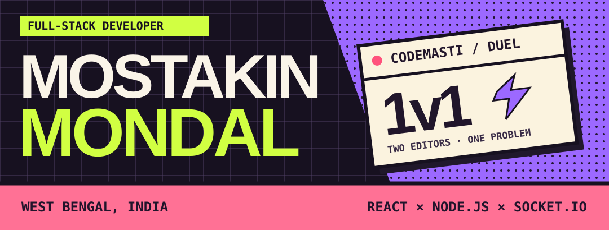

<p align="center"><a href="https://codemasti.fun"></a> <a href="https://linkedin.com/in/mostakin-mondal-m42"></a> <a href="mailto:m.mostakin5840@gmail.com"></a></p>

## ⚡ CodeMasti

**Two players open the same problem. Both editors go live. The first accepted solution wins.** I built that match flow for CodeMasti, my coding practice platform. You can also solve a daily challenge, enter a weekly contest, or ask for a hint when you're stuck.

| Inside the editor | Behind the match |
| --- | --- |
| I paired Monaco with Judge0 so players can write code, run it against test cases, and see the verdict in the same place. | Socket.IO keeps both players in sync from the ready check to the result. I deployed the app on EC2 with Nginx and PM2. |

**[Open CodeMasti ↗](https://codemasti.fun)**

## ✳ More from my workbench

**Realtime chat** · I built a Discord-style chat project to explore what happens after someone hits Send. WebSockets handle live connections, Kafka carries message events, and Redis tracks who's online. [Frontend ↗](https://github.com/mostakin5290/Discord-FE) · [Backend ↗](https://github.com/mostakin5290/Discord-BE)

**Coder Army** · As a full-stack intern, I wrote the APIs that serve courses and save students' progress. I also worked on the article editor and discussions using Next.js, Prisma, and MongoDB.

**Nexus+ Hackathon** · I entered solo and placed second in 2025.

## 🧰 My stack


## 📡 Coding activity


<details>
<summary><strong>Weekly coding time · WakaTime</strong></summary>

<!--START_SECTION:waka-->

```txt
From: 24 October 2026 - To: 31 October 2026

Total Time: 0 secs

No activity tracked
```

<!--END_SECTION:waka-->

</details>

---

**Open to full-stack roles and freelance projects.** [Email me ↗](mailto:m.mostakin5840@gmail.com) · [LeetCode ↗](https://leetcode.com/u/Mostakin42/) · [X ↗](https://twitter.com/mostakin_42)
